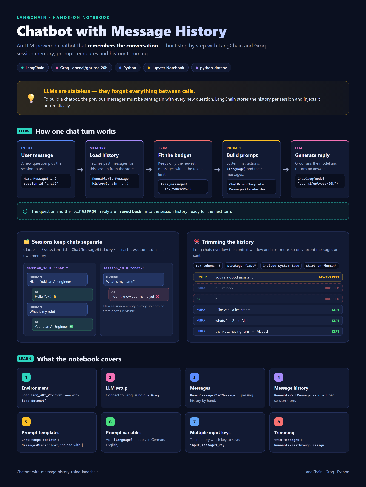
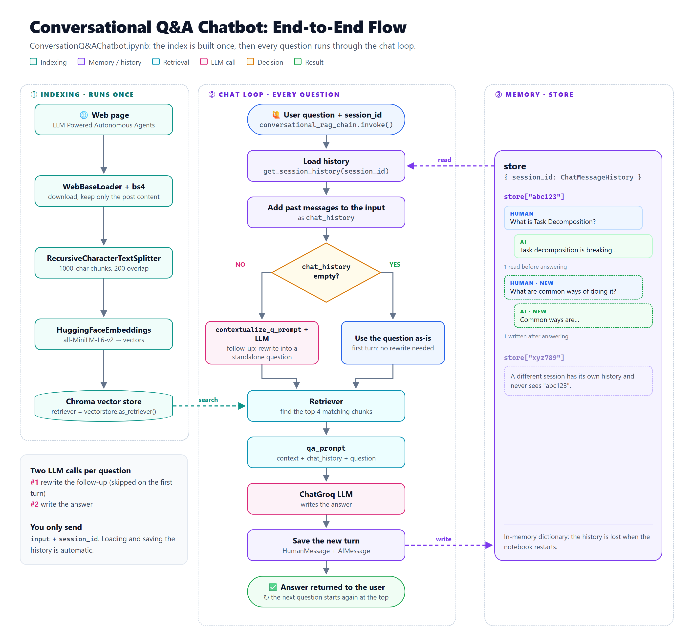

# Chatbot with Message History using LangChain

LLM-powered chatbots that **remember the conversation**, built step by step in Jupyter notebooks with **LangChain** and **Groq**.

The repo has two notebooks:

1. **`chatbots.ipynb`**: a chatbot with session-based memory, prompt templates and history trimming.
2. **`ConversationQ&AChatbot.ipynb`**: a **conversational RAG** chatbot that answers questions about a web page and understands follow-up questions.



## 💡 The key idea

LLMs are **stateless**: they don't remember anything between calls. To build a chatbot, the previous messages have to be sent again with every new question. LangChain's `RunnableWithMessageHistory` stores the history for each session and sends it to the model automatically.

## 📘 Notebook 1: Chatbot with message history

`chatbots.ipynb`

| # | Topic | Main LangChain pieces |
|---|---|---|
| 1 | Load the API key from `.env` | `load_dotenv()` |
| 2 | Connect to the LLM | `ChatGroq(model="openai/gpt-oss-20b")` |
| 3 | Chat with messages, passing history by hand | `HumanMessage`, `AIMessage` |
| 4 | Automatic message history with sessions | `ChatMessageHistory`, `RunnableWithMessageHistory`, `session_id` |
| 5 | Prompt templates | `ChatPromptTemplate`, `MessagesPlaceholder`, `prompt \| model` |
| 6 | Extra prompt variables | `{language}` in the system prompt |
| 7 | Memory with multiple input keys | `input_messages_key="messages"` |
| 8 | Trimming the conversation history | `trim_messages`, `RunnablePassthrough.assign`, `itemgetter` |

**How one chat turn works:**

1. **User message** comes in with a `session_id`.
2. **Load history**: `RunnableWithMessageHistory` fetches the past messages for that session from the store.
3. **Trim**: `trim_messages` keeps only the newest messages that fit in the token budget (`max_tokens=45`, `strategy="last"`), and always keeps the system message.
4. **Build prompt**: `ChatPromptTemplate` combines the system instructions, `{language}` and the chat messages.
5. **Generate reply**: `ChatGroq` returns an `AIMessage`.
6. **Save back**: the question and the reply are added to the session history for the next turn.

Each `session_id` has its own history, so different chats never share memory.

## 📗 Notebook 2: Conversational Q&A chatbot (RAG)

`ConversationQ&AChatbot.ipynb`

This chatbot answers questions about Lilian Weng's blog post [*LLM Powered Autonomous Agents*](https://lilianweng.github.io/posts/2023-06-23-agent/) using **RAG (Retrieval-Augmented Generation)**. It also remembers the conversation, so a follow-up like *"What are common ways of doing **it**?"* still works.



| # | Topic | Main LangChain pieces |
|---|---|---|
| 1–2 | Load keys and connect to the LLM | `load_dotenv()`, `ChatGroq` |
| 3 | Embeddings | `HuggingFaceEmbeddings("all-MiniLM-L6-v2")` |
| 4–5 | Load the web page | `WebBaseLoader`, `bs4.SoupStrainer` |
| 6 | Split into chunks and store the vectors | `RecursiveCharacterTextSplitter`, `Chroma` |
| 7 | Retriever | `vectorstore.as_retriever()` |
| 8–10 | Basic RAG chain | `create_stuff_documents_chain`, `create_retrieval_chain` |
| 11 | Rewrite follow-up questions using the history | `create_history_aware_retriever`, `contextualize_q_prompt` |
| 12 | Pass the chat history by hand | `chat_history` list of `HumanMessage` / `AIMessage` |
| 13 | Automatic history per session | `RunnableWithMessageHistory` with `input_messages_key`, `history_messages_key`, `output_messages_key` |

**Two prompts, two LLM calls per turn:**

- `contextualize_q_prompt` **rewrites** the follow-up into a standalone question for searching (skipped on the first turn).
- `qa_prompt` **answers** it using the retrieved chunks (`{context}`) and the chat history.

### 📑 Slides: how automatic conversation history works

[**conversation-history-slides.pdf**](assets/conversation-history-slides.pdf) is an 11-slide walkthrough of one turn through `conversational_rag_chain`:

ask → load history → inject → rewrite → retrieve → answer → return → save → answer

## 🛠️ Tech stack

- Python
- [LangChain](https://python.langchain.com/) (`langchain-core`, `langchain-community`, `langchain-classic`, `langchain-text-splitters`)
- [Groq](https://groq.com/) via `langchain-groq`
- [Chroma](https://www.trychroma.com/) vector store via `langchain-chroma`
- Hugging Face embeddings via `langchain-huggingface`
- `beautifulsoup4`, `python-dotenv`
- Jupyter Notebook

## 🚀 Getting started

1. **Clone the repo**

   ```bash
   git clone https://github.com/yokeswarans/Chatbot-with-message-history-using-langchain.git
   cd Chatbot-with-message-history-using-langchain
   ```

2. **Install the packages**

   ```bash
   pip install langchain-core langchain-community langchain-classic langchain-text-splitters \
               langchain-groq langchain-chroma langchain-huggingface \
               beautifulsoup4 python-dotenv ipykernel
   ```

3. **Add your API keys.** Create a `.env` file in the project folder:

   ```env
   GROQ_API_KEY=your_groq_api_key_here
   HF_TOKEN=your_huggingface_token_here
   ```

   - Get a free Groq key from the [Groq Console](https://console.groq.com/keys).
   - Get a Hugging Face token from [Hugging Face settings](https://huggingface.co/settings/tokens). It's only needed for notebook 2.
   - `.env` is already listed in `.gitignore`, so your keys won't be committed.

4. **Run the notebooks.** Open `chatbots.ipynb` first, then `ConversationQ&AChatbot.ipynb`, in Jupyter or VS Code, and run the cells from top to bottom.

## 📁 Project structure

```
├── chatbots.ipynb                         # Notebook 1: chatbot with message history
├── ConversationQ&AChatbot.ipynb           # Notebook 2: conversational RAG Q&A chatbot
├── assets/
│   ├── chatbot-infographic.png            # Infographic used in this README
│   ├── qa-chatbot-flowchart.png           # End-to-end flowchart of notebook 2
│   └── conversation-history-slides.pdf    # Slides: how automatic history works
├── .env                                   # Your API keys (not committed)
├── .gitignore
└── README.md
```
